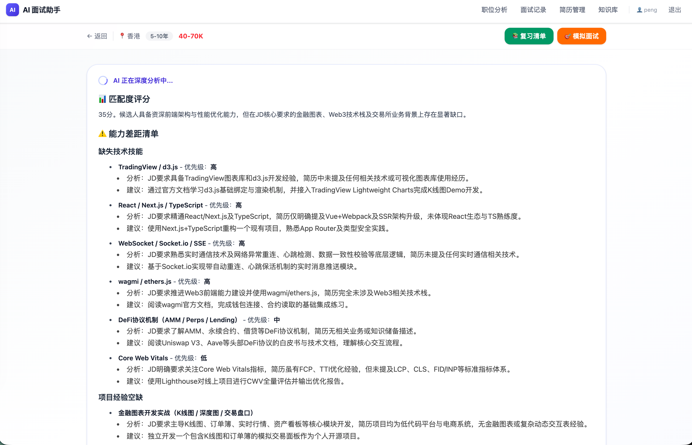
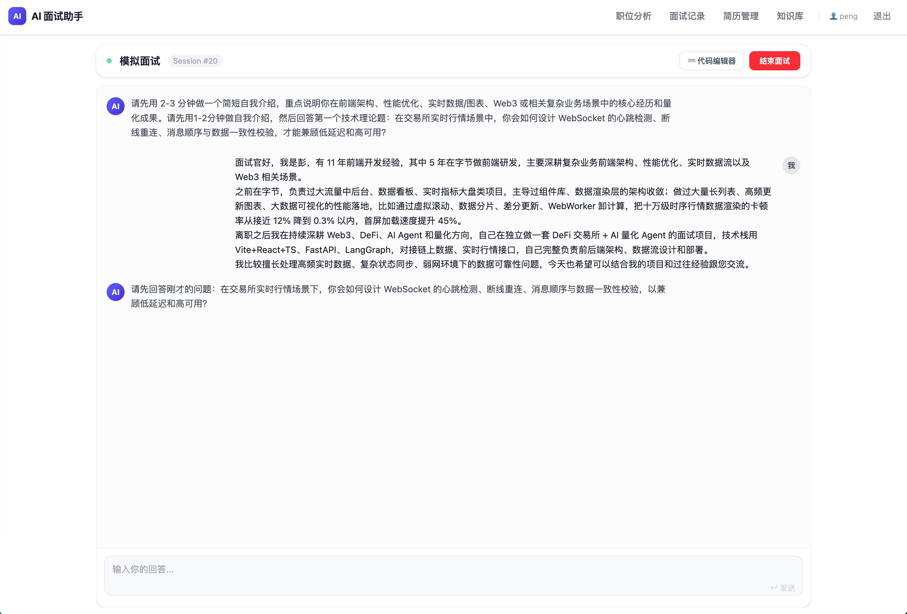
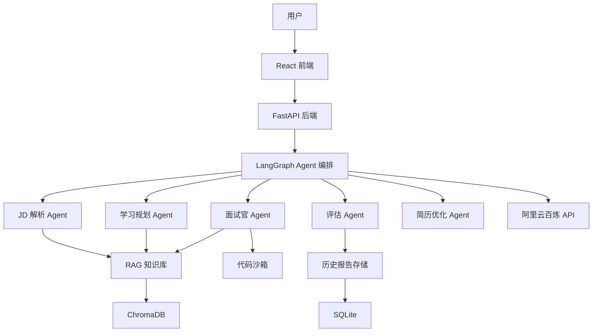
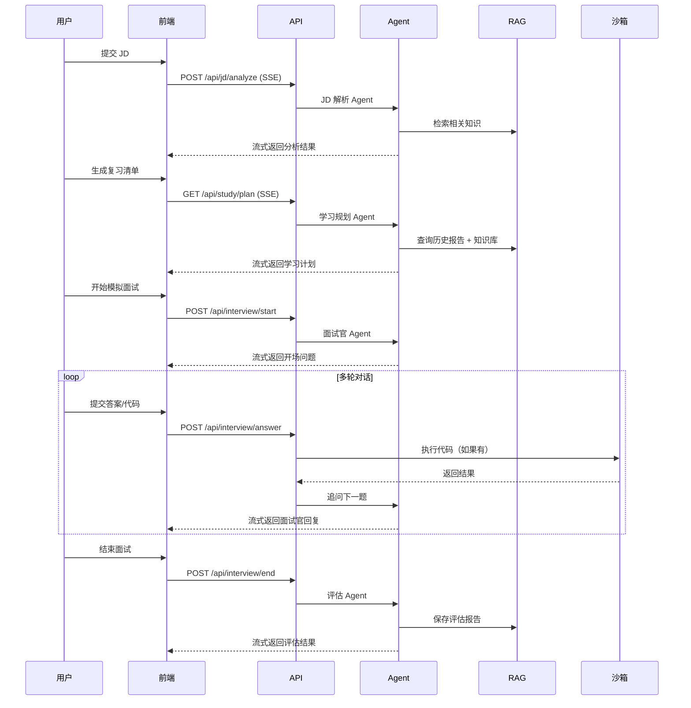

<div align="center">

# 🎯 AI Interview Assistant

**AI 驱动的技术面试备考助手**

[](https://opensource.org/licenses/MIT)
[](https://www.python.org/downloads/)
[](https://fastapi.tiangolo.com)
[](https://react.dev)

[English](./README.en.md) | 简体中文

[在线演示](#) • [快速开始](#快速开始) • [部署指南](./DEPLOY.md) • [贡献指南](./CONTRIBUTING.md)

</div>

---

## ✨ 特性

<table>
<tr>
<td width="50%">

### 🔍 智能 JD 解析
- 自动提取技术栈和任职要求
- AI 评估岗位匹配度
- 识别能力短板和学习重点

</td>
<td width="50%">

### 📚 个性化学习计划
- 基于 JD 生成针对性复习清单
- RAG 知识库提供权威资料
- 优先级排序，高效备考

</td>
</tr>
<tr>
<td width="50%">

### 🎤 真实模拟面试
- 多轮连环追问，还原真实面试
- 在线代码编辑器 + 沙箱判题
- 支持理论题、算法题、系统设计题

</td>
<td width="50%">

### 📊 结构化评估报告
- 分项打分（理论/代码/表达/分析）
- 薄弱知识点汇总
- 针对性改进建议

</td>
</tr>
<tr>
<td width="50%">

### 🔄 薄弱点追踪
- 自动读取历史面试记录
- 二次面试优先考察薄弱点
- 避免重复，提高训练效率

</td>
<td width="50%">

### ✍️ 简历优化助手
- 对照 JD 优化项目描述
- 技术关键词对齐
- 提升简历通过率

</td>
</tr>
</table>

---

## 🎬 演示

### JD 智能解析


### 模拟面试 + 代码判题


### 面试评估报告


> 📸 截图待添加，欢迎贡献！

---

## 🚀 快速开始

### 前置要求

- Python 3.11+
- Node.js 18+
- 阿里云百炼 API Key（[获取地址](https://bailian.console.aliyun.com/)）

### 一键启动

```bash
# 1. 克隆仓库
git clone https://github.com/A-FE/ai-interview-assistant.git
cd ai-interview-assistant

# 2. 配置环境变量
cp .env.example .env
# 编辑 .env，填入你的 DASHSCOPE_API_KEY

# 3. 一键启动（自动安装依赖 + 初始化知识库）
./start.sh
```

### 访问应用

- 🌐 前端：http://localhost:5173
- 📡 后端 API 文档：http://localhost:8000/docs

### 手动安装（可选）

<details>
<summary>展开查看详细步骤</summary>

#### 后端

```bash
# 创建虚拟环境
python -m venv .venv
source .venv/bin/activate  # Windows: .venv\Scripts\activate

# 安装依赖
pip install -r requirements.txt

# 初始化 RAG 知识库（首次执行）
python -m backend.rag.init_kb

# 启动后端
uvicorn backend.main:app --reload --port 8000
```

#### 前端

```bash
cd frontend

# 安装依赖
npm install

# 启动开发服务器
npm run dev
```

</details>

---

## 🏗️ 技术架构

### 技术栈

| 模块 | 技术 |
|------|------|
| **后端框架** | FastAPI + SQLAlchemy (异步) |
| **AI 编排** | LangGraph + LangChain |
| **LLM** | Qwen (阿里云百炼 API) |
| **向量数据库** | ChromaDB |
| **数据库** | SQLite (可迁移到 PostgreSQL) |
| **前端框架** | React 19 + TypeScript + Vite |
| **UI 框架** | Tailwind CSS v4 |
| **代码编辑器** | Monaco Editor |
| **路由** | React Router v7 |

### 系统架构



### 核心面试流程



---

## 📁 项目结构

```
ai-interview-assistant/
├── backend/                    # 后端代码
│   ├── agents/                # LangGraph Agents
│   │   ├── jd_parser.py       # JD 解析
│   │   ├── study_planner.py   # 学习规划（含薄弱点模式）
│   │   ├── interviewer.py     # 技术面试官
│   │   ├── evaluator.py       # 面试评估
│   │   └── resume_optimizer.py # 简历优化
│   ├── models/                # SQLAlchemy ORM 模型
│   ├── routers/               # FastAPI 路由
│   ├── tools/                 # Agent 工具
│   │   ├── rag_tool.py        # RAG 检索
│   │   ├── code_sandbox.py    # 代码沙箱
│   │   └── report_reader.py   # 历史报告读取
│   ├── rag/                   # RAG 知识库
│   │   ├── init_kb.py         # 初始化脚本
│   │   └── data/              # Markdown 知识文档
│   ├── main.py                # FastAPI 应用入口
│   ├── config.py              # 配置管理
│   └── database.py            # 数据库连接
│
├── frontend/                  # 前端代码
│   ├── src/
│   │   ├── pages/             # 页面组件
│   │   │   ├── Home.tsx
│   │   │   ├── JDAnalysis.tsx
│   │   │   ├── StudyPlan.tsx
│   │   │   ├── Interview.tsx
│   │   │   └── Report.tsx
│   │   ├── components/        # 可复用组件
│   │   │   ├── ChatWindow.tsx
│   │   │   ├── MarkdownRenderer.tsx
│   │   │   └── Header.tsx
│   │   ├── api/               # API 封装
│   │   ├── hooks/             # 自定义 Hooks
│   │   └── types/             # TypeScript 类型
│   ├── package.json
│   └── vite.config.ts
│
├── docs/                      # 文档
│   ├── DEPLOY.md              # 部署总览
│   ├── DEPLOY_RAILWAY.md      # Railway 部署
│   ├── DEPLOY_FLY.md          # Fly.io 部署
│   └── DEPLOY_RENDER.md       # Render 部署
│
├── .env.example               # 环境变量模板
├── requirements.txt           # Python 依赖
├── Dockerfile                 # Docker 镜像
├── docker-compose.yml         # 本地开发环境
├── start.sh                   # 一键启动脚本
├── CONTRIBUTING.md            # 贡献指南
├── LICENSE                    # MIT 许可证
└── README.md                  # 本文件
```

---

## 📖 使用指南

### 1️⃣ 注册 / 登录

- 支持注册账号或游客模式体验
- 游客模式功能完整，数据临时保存

### 2️⃣ 分析 JD

1. 粘贴目标岗位的 JD 文本
2. （可选）上传简历，获取个性化匹配分析
3. AI 自动提取技术栈，评估匹配度

### 3️⃣ 生成学习计划

- 基于 JD 分析结果生成复习清单
- 如果有历史面试记录，优先聚焦薄弱点
- 分类展示：知识点、算法题型、项目方向

### 4️⃣ 模拟面试

- 点击"开始面试"进入对话界面
- 面试官逐题提问，支持文字和代码回答
- 代码题自动运行沙箱判题
- 面试官根据回答追问深挖

### 5️⃣ 查看报告

- 面试结束后自动生成评估报告
- 包含总分、分项打分、每题点评
- 薄弱知识点汇总供下次复习参考

### 6️⃣ 薄弱点专项训练

- 再次生成学习计划时，自动读取历史报告
- 复习清单优先聚焦历史薄弱点
- 二次面试时优先考察薄弱知识点

---

## 🌐 部署

### 云端部署（推荐）

本项目支持前后端分离部署：

- **前端**：部署到 [Vercel](https://vercel.com)（免费）
- **后端**：部署到 [Railway](https://railway.app) / [Fly.io](https://fly.io) / [Render](https://render.com)

#### 快速部署

```bash
# 前端部署到 Vercel
npm i -g vercel
vercel --prod

# 后端部署到 Railway
npm i -g @railway/cli
railway login
railway up
```

📚 **详细部署指南**：
- [Vercel 前端部署](./DEPLOY.md)
- [Railway 后端部署](./DEPLOY_RAILWAY.md)（推荐）
- [Fly.io 部署](./DEPLOY_FLY.md)（生产级）
- [Render 部署](./DEPLOY_RENDER.md)（简单易用）

### Docker 部署

```bash
# 使用 Docker Compose 一键启动
docker-compose up -d

# 访问
# 前端: http://localhost:5173
# 后端: http://localhost:8000
```

---

## 🤝 贡献

我们欢迎所有形式的贡献！

- 🐛 [报告 Bug](https://github.com/A-FE/ai-interview-assistant/issues/new)
- 💡 [提出新功能](https://github.com/A-FE/ai-interview-assistant/issues/new)
- 📝 改进文档
- 🔀 提交 Pull Request

请阅读 [贡献指南](./CONTRIBUTING.md) 了解详情。

### 贡献者

感谢所有为本项目做出贡献的开发者！

<a href="https://github.com/A-FE/ai-interview-assistant/graphs/contributors">
  
</a>

---

## 📊 开发路线图

- [x] 核心功能实现
  - [x] JD 智能解析
  - [x] 学习计划生成
  - [x] 模拟面试 + 代码沙箱
  - [x] 评估报告 + 薄弱点追踪
  - [x] 简历优化
- [x] 部署支持
  - [x] Vercel 前端部署
  - [x] Railway / Fly.io / Render 后端部署
  - [x] Docker / Docker Compose
- [ ] 功能增强
  - [ ] 支持更多编程语言（JavaScript、Java、Go）
  - [ ] 系统设计题支持
  - [ ] 行为面试（Behavioral Interview）
  - [ ] 面试录音回放
  - [ ] 多用户协作（模拟双人技术面试）
- [ ] 技术优化
  - [ ] 添加单元测试和集成测试
  - [ ] 支持 PostgreSQL 数据库
  - [ ] 优化 RAG 检索准确率
  - [ ] 添加 Redis 缓存
- [ ] 国际化
  - [ ] 英文界面
  - [ ] 多语言支持

---

## ⚠️ 注意事项

### 代码沙箱安全

- 当前代码沙箱基于 Python `subprocess` + `resource` 限制
- 仅适用于演示和个人使用
- **生产环境建议**：
  - 使用第三方沙箱服务（如 [Judge0](https://judge0.com/)、[Piston](https://github.com/engineer-man/piston)）
  - 或使用 Docker 容器隔离

### API Key 安全

- 不要将 `.env` 文件提交到 Git
- 生产环境修改 `SECRET_KEY`
- 定期轮换 `DASHSCOPE_API_KEY`

### 数据隐私

- 用户数据存储在本地 SQLite
- 不会上传到第三方服务器
- 部署到云端时注意配置访问权限

---

## 📄 许可证

本项目采用 [MIT 许可证](./LICENSE)。

---

## 🙏 致谢

### 开源项目

- [FastAPI](https://fastapi.tiangolo.com/) - 现代化的 Python Web 框架
- [LangChain](https://www.langchain.com/) / [LangGraph](https://langchain-ai.github.io/langgraph/) - AI Agent 编排
- [ChromaDB](https://www.trychroma.com/) - 向量数据库
- [React](https://react.dev/) - 前端框架
- [Tailwind CSS](https://tailwindcss.com/) - CSS 框架
- [Monaco Editor](https://microsoft.github.io/monaco-editor/) - 代码编辑器

### AI 服务

- [阿里云百炼](https://www.aliyun.com/product/bailian) - 提供 Qwen 大模型 API

---

## 📮 联系方式

- 项目主页：https://github.com/A-FE/ai-interview-assistant
- 问题反馈：[GitHub Issues](https://github.com/A-FE/ai-interview-assistant/issues)
- 讨论区：[GitHub Discussions](https://github.com/A-FE/ai-interview-assistant/discussions)

---

<div align="center">

**如果这个项目对你有帮助，请给个 ⭐️ Star 支持一下！**

Made with ❤️ by [A-FE](https://github.com/A-FE) and [Contributors](https://github.com/A-FE/ai-interview-assistant/graphs/contributors)

</div>
